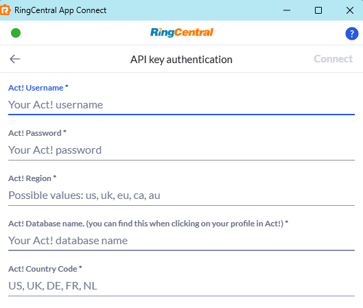
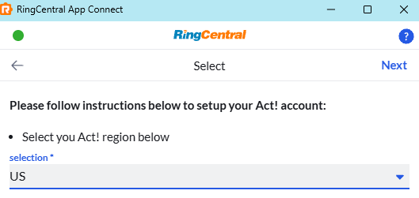

# Act! by Loyally

Act! CRM is an all-in-one relationship management and marketing automation platform designed to help small and mid-sized businesses centralize customer data, optimize sales pipelines, and drive growth. 

RingCentral supports Act! via a trusted third-party vendor and Premium Partner [Loyally](https://loyally.eu/).

!!! money "As a third-party integration, the Act! integration comes at an additional cost"

## Setup and configuration

### Sign up for Act!

The Act! integration is a paid, third-party integration provided by Loyally. Sign up to get started.

[Purchase the Connector](https://buy.stripe.com/dRm4gzal7cYh3WRaGpdUY1h){ .md-button .md-button--primary }

### Install the extension

If you have not already done so, begin by [installing App Connect](https://chromewebstore.google.com/detail/ringcentral-app-connect/kkhkjhafgdlihndcbnebljipgkandkhh?hl=en) from the Chrome web store. 

### Connect to Act!

Once the App Connect extension has been installed, follow these steps to setup and configure the extension for Act!. 

1. Login to your Act! account.

2. While visiting a Act! application page, click the App connect quick access button to bring the application to the foreground. 
   Or open the extension directly via the "puzzel icon" next to your URL address bar.
   
3. Select Act! in the list of connectors. 

4. Input the required credentials and related information as displayed below.

    

5. Next you need to select your Act region.

    

6. Click the "Next" button. 

When you login successfully, the extension will automatically update to show you are connected to Act!. If you are connected, the button next to Act! will say, "logout".

And with that, you will be connected to Act! and ready to begin using the integration. 
Be sure to read the user guide to configure the integration to your needs.
You can find the guide [here](https://appconnect.labs.ringcentral.com/users/access/)