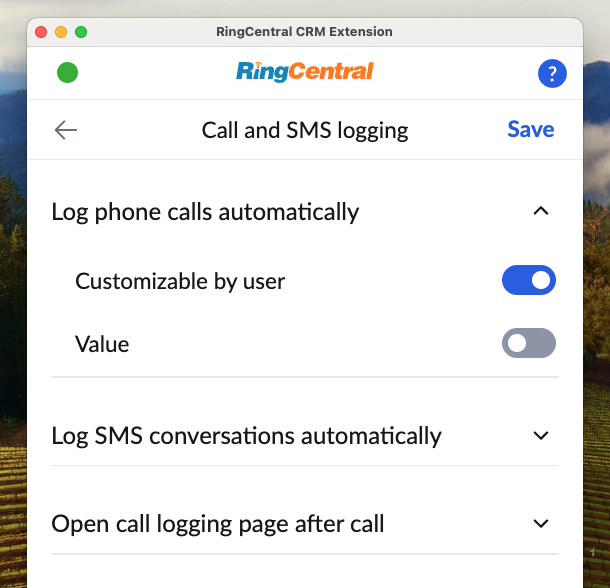
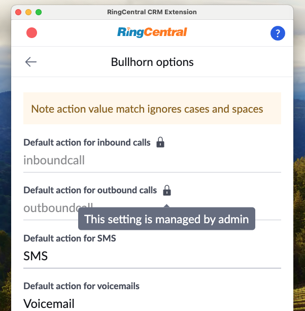
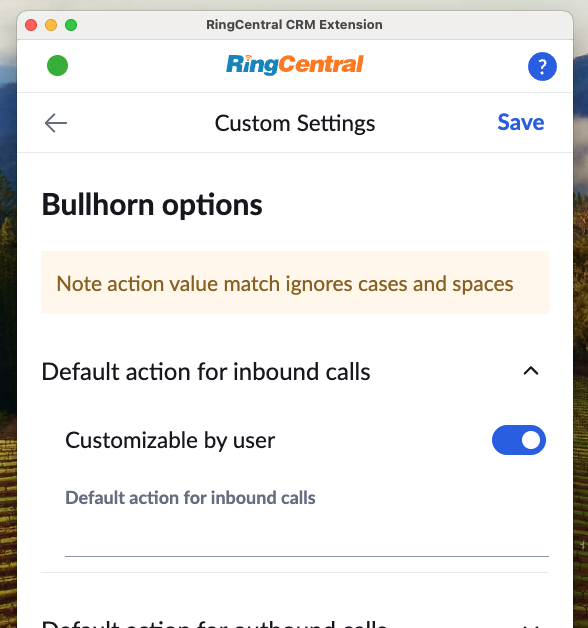

# Managing settings on behalf of others

Once you have access to the Admin tab, admins can manage the following:

* Call and SMS logging settings
* Contact and call-pop settings
* Do not contact lists
* CRM-specific settings
* Advanced settings
* Set the custom CRM manifest URL

<figure markdown>
  { .mw-400 }
  <figcaption>Admins can set call logging policies</figcaption>
</figure>

For each setting that can be managed by an admin, one can do the following:

* Mandate the setting be a specific value. This is done by disabling the user's ability to customize the value, and select the value you prefer. 
* Set the default value of a setting. This is done by setting the preferred value, and by enabling the user to customize the value. 

## What users within your account will see

When a setting is mandated by an admin, a lock icon will appear next to the setting and it will be disabled, thereby allowing the user to see the value, but be unable to change it. 

<figure markdown>
  { .mw-400 }
  <figcaption>Admins can manage CRM-specific settings</figcaption>
</figure>

## Blocking or warning on specific numbers

Admins can keep their users from calling or texting certain phone numbers. In the extension, open the Admin tab, then **Managed settings > Do not contact**. In the Admin Console, use the **Do not contact** tab under Managed settings. There are two lists:

* **Block list**: calls and texts to these numbers are blocked, and users see a message explaining why.
* **Warn list**: users see a warning and can choose to continue.

If a number is on both lists, the block list wins. For a text sent to several people, a single blocked number blocks the whole message.

Add one entry per row, in any of these forms:

| Entry | Example | Matches |
| --- | --- | --- |
| Full number | `+14155551234` or `(415) 555-1234` | That number, however the user dials it. Numbers without a country code are read in the region selected in the extension |
| Extension | `1234` | Only that extension (6 digits or fewer) |
| Wildcard | `+1415*` | Any number that starts with `+1415`. A `*` stands for any run of digits, so `+1*55*71` also works. Wildcards must start with `+` and a country code |

!!! note "Good to know"
    * Users can't see or change these lists, and there is no "editable by users" option.
    * The lists apply to calls and texts started from the App Connect widget, including click-to-dial and call-back lists. Incoming calls and other RingCentral apps aren't affected.
    * Needs RingCentral Embeddable 2.0.0 or later, which App Connect includes.
    * If the check can't run for any reason, the call or text goes through.

## Managing CRM-specific settings

Each CRM supported by App Connect may expose custom settings. These settings can be managed under the area labeled as "Custom options."

<figure markdown>
  { .mw-400 }
  <figcaption>Admins can manage CRM-specific settings</figcaption>
</figure>

