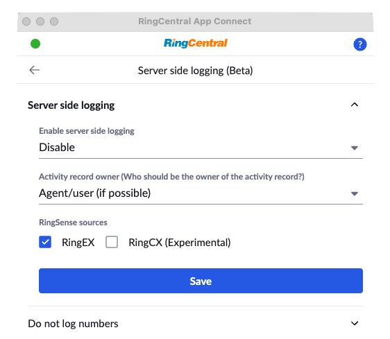

# RingCX support in App Connect

<!-- md:version 2.1-beta -->

Starting with the App Connect 2.1 beta, contact center agents can use App Connect with RingCX as well as RingEX. Agents and knowledge workers work from the same extension, with the same CRM connectors and the same logging and screen-pop behavior. See [What's new in App Connect 2.1](../2.1/index.md) for how to install the 2.1 beta.

RingCX calls can be logged to your CRM in two ways:

* **[Client-side logging](#logging-ringcx-calls-from-the-extension)**: agents log calls from the App Connect extension while they handle them.
* **[Server-side logging](#setting-up-ringcx-logging)**: App Connect logs answered RingCX calls automatically, even when no agent has the extension open.

## Making and receiving RingCX calls

<!-- md:version 2.1-beta -->

In the 2.1 beta, agents sign in to RingCX inside App Connect and handle their calls there, including inbound queue calls, manual outbound calls, and dial group (campaign) calls. App Connect matches the caller to a contact in your CRM, as it does for RingEX calls.

## Logging RingCX calls from the extension

<!-- md:version 2.1-beta -->

When a RingCX call ends, App Connect shows the CRM call logging form on the RingCX wrap-up page, so the agent can log the call without leaving wrap-up. If the call log cannot be saved, App Connect shows the error on the wrap-up page.

With one-time logging enabled, RingCX calls save directly from wrap-up. If App Connect has already logged the call, saving from wrap-up updates the title and note on the existing log. App Connect also saves the disposition and queue or campaign when their [Call log details](logging.md#controlling-what-information-gets-logged) settings are enabled and wrap-up provides those values. App Connect warns you if it could not save a contact change, an additional contact link, or a custom field.

Client-side logging needs the agent to have the extension open. To log calls for every agent, also set up [server-side logging](#setting-up-ringcx-logging).

## Server-side logging for RingCX

<!-- md:version 2.1-beta -->

Server-side logging for RingCX builds on [server-side call logging](server-side-logging.md) for RingEX. RingCX sends a call event to App Connect when each call ends, and App Connect creates the call log in your CRM with the admin's CRM connection.

### Prerequisites

* **RingCX license**: an active RingCX subscription.
* **Server-side call logging**: an App Connect admin can enable it. See [Enabling server-side call logging](server-side-logging.md#enabling-server-side-call-logging).
* **RingCX admin access**: someone who can open **Settings > Accounts** in RingCX Admin and edit the **Integrations** of each sub-account. If **Generic HTTP** is not available on a sub-account, contact your RingCentral account manager.

RingSense (ACE) for RingCX is not required. If your account has it, see [Adding transcripts and AI summaries](#adding-transcripts-and-ai-summaries).

### Setting up RingCX logging

Setup has two parts. An App Connect admin turns on RingCX in Universal Logging and copies the call events URL and header value. Then a RingCX admin adds them to each RingCX sub-account.

#### Step 1: Turn on RingCX in App Connect

1. Open the **Admin** tab in App Connect, or the [admin console](admin-console.md).
2. Open **Universal Logging**.
3. Under **Enable server side logging**, choose **Enable for account**, or **Enable for admin only (trial mode)** to try it first.
4. Under **Call sources**, select **RingCX (Experimental)**. Keep **RingEX** selected if you also log RingEX calls.
5. Select **Save changes**.

<figure markdown>
  { .mw-400 }
  <figcaption>The Admin settings showing both RingEX and RingCX (Experimental) checkboxes selected under Server Side Logging.</figcaption>
</figure>

After you save, the page shows:

* **RingCX call events URL**: the URL that RingCX sends call events to. Select **Copy URL**.
* **RingCX header name**: the name of the custom header that RingCX must send, `x-ringcx-webhook-secret`.
* **RingCX header value**: the secret value of that header. Select **Copy value**.

If no URL is shown, select **Generate URL**.

!!! warning "Keep the URL and header value private"
    Together, the URL and header value let anyone send call events to App Connect for your account. Treat them like a password. Only the admin who set up server-side logging can see them.

#### Step 2: Add the call events URL in RingCX

Repeat these steps for each RingCX sub-account whose calls you want to log.

1. In RingCX Admin, go to **Settings > Accounts**, select the sub-account, and open **Integrations > Generic HTTP**.
2. Paste the RingCX call events URL as the **Call Event URL**, and turn on **Send body as JSON**.
3. Turn on both the **Call Ended** event and the **Outbound call** event. Without the **Outbound call** event, dial group (campaign) calls are not sent.
4. Add a custom header. Enter `x-ringcx-webhook-secret` as the header name and the RingCX header value as its value.
5. Save.

!!! info "App Connect rejects call events without the header"
    If the header is missing or its value is wrong, App Connect does not log the call. When calls are not logged, check the header name and value first.

#### Regenerating the URL and header value

If the URL or header value may have been exposed, select **Regenerate URL** on the Universal Logging page. The current URL and header value stop working immediately. Copy the new URL and header value, and update both in every RingCX sub-account that uses them.

### What is logged

* **Calls**: answered inbound queue calls, manual outbound calls, and dial group (campaign) calls. Abandoned, deflected, and answering-machine calls are not logged.
* **Call details**: the contact matched by the customer's phone number, the call direction, start time, and duration.
* **Recording link**: a link to the RingCX call recording when the call was recorded, following your admin settings for call log details. Opening the recording requires RingCX access.

Each call is logged once. If RingCX sends the event again, or RingSense also reports the call, App Connect does not create a second call log.

### Activity record owner

By default, RingCX call logs are created with the admin's CRM connection and owned by the admin.

To assign each call log to the agent, set **Activity record owner** to **Agent/user (if possible)**. App Connect then looks for the agent's CRM user:

* through the agent's RingCentral user, once App Connect has learned which RingCentral user the agent is, or
* through the RingCX agent ID, using the admin's [user mapping](server-side-logging.md#activity-record-owner).

If App Connect cannot find a CRM user for the agent, the call log stays with the admin. Assigning call logs to agents also depends on your CRM connector.

In the 2.1 beta extension, search the **User mapping** list by RingCX agent ID to find the mapped CRM user. Use the Admin console to add or change RingCX agent IDs.

### Adding transcripts and AI summaries

The RingCX call event does not include a transcript or an AI summary. If your account has **RingSense (ACE) for RingCX**, enable RingSense on the RingCX sub-account. When RingSense finishes processing a recorded call, usually several minutes after the call ends, App Connect adds the transcript and summary to the call log it already created, following your admin settings for call log AI notes and transcripts. See [AI Conversation Expert (ACE) logging](ace.md).

### Limitations

* **Per-user CRM connections are not supported**: RingCX call logs are always created with the admin's CRM connection, and assigned to the agent when possible.
* **Dispositions and agent notes**: the RingCX call event omits these details. Agents can add notes from the extension's wrap-up form and save custom fields when their CRM supports updating those fields on existing logs.
* **Transfers**: a transferred call is logged once, owned by the first agent who answered it.
* **Logging conflicts**: if a call matches no contact, or more than one contact, App Connect follows your unknown-contact and multiple-contact settings. Agents cannot resolve these conflicts for server-side RingCX call logs.
